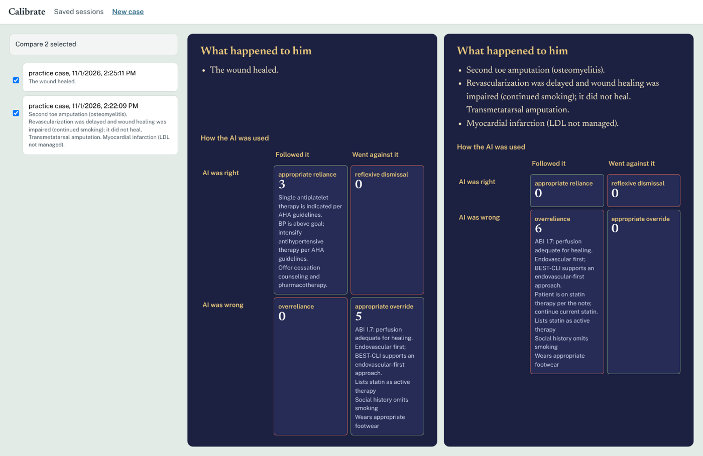
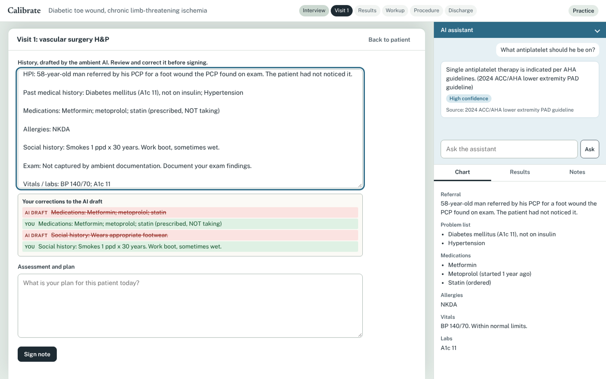
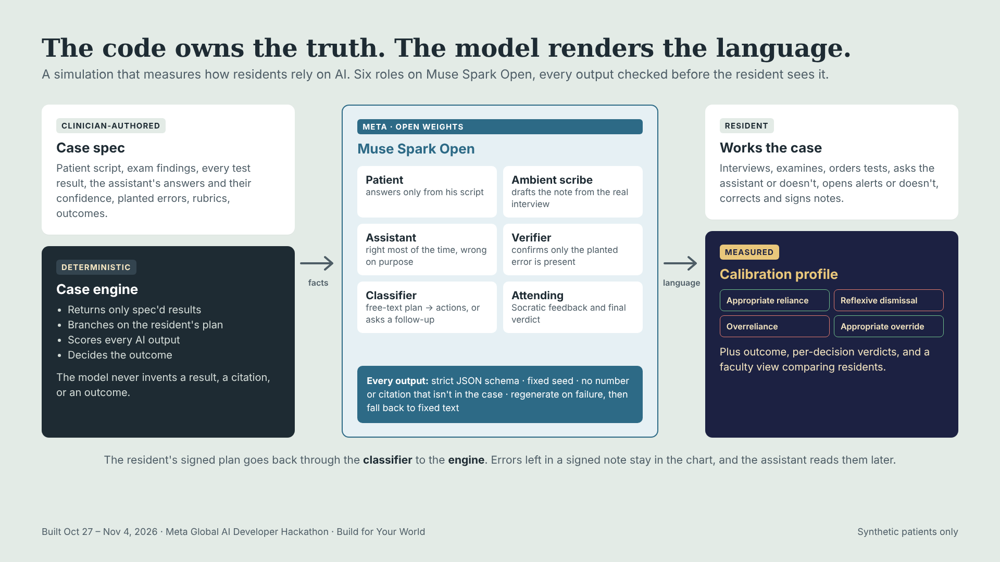

# Calibrate

**A simulation that measures how surgical residents rely on AI: when they trust it, when they override it, and whether they were right.**

Meta Global AI Developer Hackathon (Oct 27 – Nov 4, 2026). Track: *Build for Your World*. Solo entry by Marissa Famularo, DO (vascular surgeon, Associate Program Director, vascular surgery residency).



## The problem

Opinions about AI in medicine split into two camps. One says it's great and you should use it for everything. The other says it hallucinates and you should never use it. Meanwhile, residents are already working alongside ambient scribes and decision-support tools, and there is no education built for doctors in training on *when* and *how* to use AI: to be efficient and safe while avoiding the pitfalls.

The skill they need is **calibrated trust**: knowing where each tool is reliable and where it isn't (mapping its frontier), then relying on it or overriding it accordingly. Programs have no way to practice or assess that skill. Calibrate is built to do both.

## What it does

A resident works a synthetic patient through a branched vascular surgery case: a 58-year-old with diabetes, a toe ulcer, and chronic limb-threatening ischemia. The resident:

1. **Interviews and examines the patient** in free text, typed or dictated. The patient is played by a model that answers only from a scripted history.
2. **Orders tests.** Results come only from the case spec. If a test isn't in the spec, the answer is "not available." If it's in the spec but not indicated, the answer says why.
3. **Works with an ambient AI assistant**, modeled on the ambient scribes residents already use. It hears the interview, reads the chart, answers questions, and sometimes raises an alert. Opening an alert is optional, and whether the resident opens it is recorded.
4. **Reviews and signs AI-drafted notes.** Each decision is an assessment and plan written into a note the resident signs. Uncorrected errors in a signed note stay in the chart, and the assistant reads them later.
5. **Gets attending feedback.** In practice mode the attending asks one Socratic question after each signed note. In assessment mode the attending stays silent until the end.
6. **Sees the outcome and a calibration profile.**

The assistant is right most of the time. It is wrong at specific, pre-defined points, sometimes with high confidence and sometimes citing a real trial in the wrong context. Some of its alerts are correct but low value. The resident is not hunting for errors. The assistant is a colleague to use well, and the resident alone is responsible for the final decisions.

### What gets measured

Every assistant output and every AI-drafted note error is scored against what the resident actually did:

|  | Resident followed it | Resident went against it |
|---|---|---|
| **AI was right** | Appropriate reliance | Reflexive dismissal |
| **AI was wrong** | Overreliance | Appropriate override |

The report also counts outputs the resident never consulted, alerts they never opened, and low-value alerts they did open. Outcomes are deterministic consequences of the resident's choices. For example, a statin listed as active in a signed note that nobody corrected means no statin gets started, and the patient has an MI.



## How it uses Meta's models

Every model call goes to **Muse Spark Open** (`meta-models/muse-spark-open-1026`, open weights, served through Baseten's OpenAI-compatible API). Each call returns structured output against a strict JSON schema, with a fixed seed. One model plays seven roles, including speech-to-text from the resident's own voice:

| Role | What it does | How it's kept honest |
|---|---|---|
| **Patient** | Answers interview questions in character | Speaks only from the scripted history and the chart. Anything unscripted is denied or normal; anything only a doctor could have told him gets "nobody told me" |
| **Ambient scribe** | Drafts the H&P from the chart and the real interview transcript | Planted note errors appear only if the patient actually said the trigger fact. A deterministic check plus a model check confirm the planted error is present and nothing else is distorted |
| **Assistant** | Routes each question to a case topic and renders the spec'd answer with its spec'd confidence; answers off-spec questions correctly from the record | No number or citation unless it's in the case. Regenerate on failure, then fall back to the spec text verbatim |
| **Verifier** | Second check on scribe and assistant outputs | Runs on top of deterministic string checks |
| **Classifier** | Maps the free-text plan to the case's action options, or returns "unclear" and the attending asks a follow-up ("What exactly is your plan?") | Never guesses. Drives branching and scoring |
| **Dictation** | Turns the resident's speech into text in any input box (patient, assistant, note, attending), straight from audio | Audio in, strict JSON out. The transcript lands in the box for the resident to review; nothing is sent automatically |
| **Attending** | Socratic feedback in practice mode; a per-decision verdict and calibration summary at the end | Uses only results the resident had seen. Never invents numbers, never shows internal IDs, always includes a line on how the resident used the AI |



**The code owns the truth, and the model renders the language.** Test results, branching, scoring, and outcomes all come from the case spec through a deterministic engine. The model never decides a result, a citation, or an outcome. Every generated output passes deterministic guards before the resident sees it. On failure it regenerates with the problems as feedback, and after that it falls back to fixed text.

## Built during the hackathon

All code in this repository was written between Oct 27 and Nov 4, 2026. Before the event, the only thing that existed was a one-paragraph concept README (see the first commits). The git history shows the build.

Built with Claude Code as the coding agent (confirmed allowed by the organizers). The clinical content (case, findings, planted errors, rubrics, outcomes) was written by the author, who has final say on all of it.

What exists now:
- **Case engine** (`calibrate/engine.py`): decision nodes, branches with consequences and recovery, two terminal branches, outcome modifiers, and calibration scoring.
- **Model roles** (`calibrate/roles/`), guards (`calibrate/guards.py`), and the runtime the UI calls (`calibrate/runtime.py`).
- **Web app** (`calibrate/server.py`, `calibrate/web/`): patient scene, note clipboard with visible corrections, assistant panel with alerts, chart, attending panel, dictation (a mic on every input), end report, and a faculty view that can compare two sessions side by side.
- **One fully branched case**, `cases/clti-01.md` (the human-readable spec) and `cases/clti-01.yaml` (what the engine reads).
- **Tests:** 61 offline tests (`python3 -m pytest -q`) walk every branch and both modes through the API using a scripted stand-in model.

## Run it

```bash
pip install -r requirements.txt
echo 'BASETEN_API_KEY=...' > .env        # Muse Spark Open via Baseten
python3 -m uvicorn calibrate.server:app --port 8000
# open http://localhost:8000   (faculty view: http://localhost:8000/#faculty)
```

No API key? `CALIBRATE_FAKE=1 python3 -m uvicorn calibrate.server:app --port 8000` runs the same app with a scripted stand-in model.

Live checks:
- `scripts/demo_rehearsal.py good|over` plays the two demo residents end to end against the live model and prints outcome and calibration.
- `scripts/run_classifier_check.py` measures classifier agreement.
- `scripts/sweep.py terse|per_pcp|bypass|visit1_orders` plays four unscripted residents (typos, deferring to the PCP, bypass without vein mapping, orders written early) and flags loops or dead ends.
- `scripts/record_demo.py` and `scripts/assemble_video.py` record the demo footage from the live app and cut the video.

## Evidence so far

- **Dictation:** Muse Spark Open transcribed the author's recorded dictation verbatim (about 6 to 7 seconds per clip), including clinical terms (ABI, non-compressible, revascularization). The transcript goes into the input box for the resident to review; nothing is sent automatically.
- **Unscripted sweep:** four differently behaved residents each reached the outcome the case rules define, with no follow-up loops.

- **Classifier:** 30/30 agreement on a 10-item check set written from the case spec (3 repeats each; median 2.4 s per call). See `docs/classifier_check_results.md`. These items are one-line plans. Agreement on full note-length plans has not been measured yet.
- **Demo runs:** a calibrated resident heals the wound (3 appropriate reliance, 5 appropriate override). An overreliant resident, on the same case, loses the toe, then needs a transmetatarsal amputation, then has an MI (6 overreliance).

## Limitations

- **One case.** Residents who take different paths meet different errors, so profiles are not fully comparable between residents.
- **The answer key is public.** The planted errors are in this repo. Real use needs private case specs.
- **Educational effect has not been studied.** This is a working instrument, not a validated assessment.
- **Synthetic patients only; no PHI anywhere.** This is a training simulation. It is not a clinical tool and does not give medical advice.
- Not yet built: more cases, spoken replies (text-to-speech), and a case-authoring agent.

## Author

Marissa Famularo, DO. Vascular surgeon, Associate Program Director (Vascular Surgery Residency), Medical Director of a Limb Preservation Program, and health data scientist.

## License

MIT. See [LICENSE](LICENSE).
